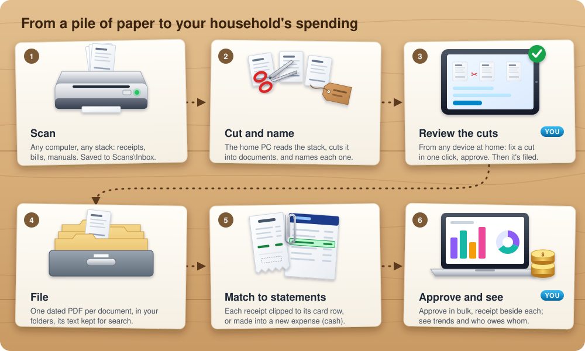
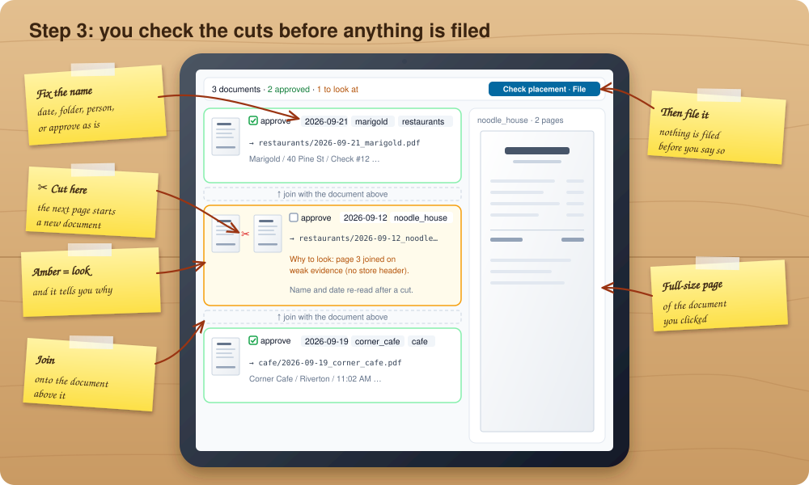
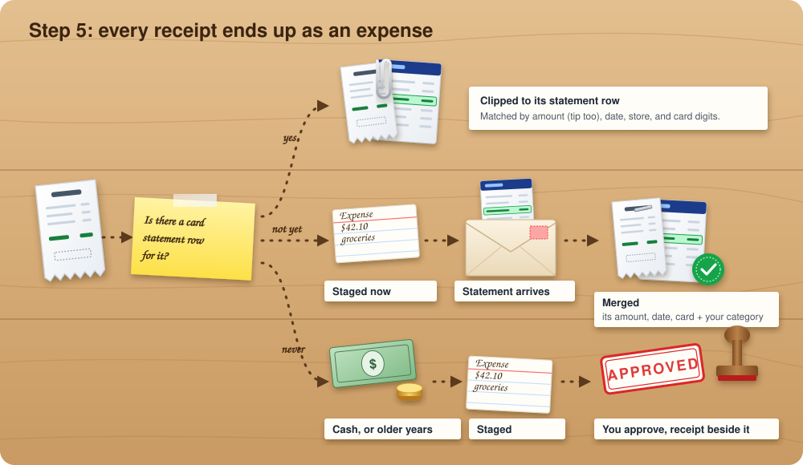

# Kitchen Table

**Self-hosted receipt scanner and household expense tracker.** Scan the paper
pile, let it file and name every receipt, match receipts to your credit card
statements, and see where the money went and who owes whom. Runs on your own
computer; your documents and data never leave it.

- **Scan anything**: a stack of receipts, bills, and manuals goes in; one
  named, dated PDF per document comes out, filed in your folders. You approve
  the page cuts before anything is filed.
- **Receipts become expenses**: matched to statement rows, or staged as new
  expenses when no statement covers them (cash, older years).
- **Household spending**: categories, trends, and a split between two people,
  with a running "who owes whom".
- **Review from any device at home**: a password-protected dashboard on your
  home network.

Built for one or two people (`HOUSEHOLD_MEMBERS`).

## How it works



Two steps need you (blue): checking how a scanned stack was cut into
documents, and approving expenses. Everything else runs in the background on
the computer that hosts the app.

It is not trying to be a generic budgeting app. It is trying to do a smaller set of things well:

- ingest messy statement data
- preserve trustworthy historical labels
- stage uncertain rows for human approval
- capture the metadata that matters to this household
- make repeated cleanup decisions easier over time

## Design Philosophy

### 1. Approval before reporting

New statement rows should not silently enter dashboards just because they imported successfully.

The application now treats uploaded rows as staged data first. They are only allowed into reports after approval. That keeps the reporting layer trustworthy and makes uncertainty visible instead of hiding it.

### 2. Trust known-good history

The original household spreadsheet export (`HOUSEHOLD_SHEET`) file is canonical history, not noisy input. The system should preserve those category assignments instead of sending them back through suspicious automation.

### 3. Preserve evidence, then normalize meaning

Merchant handling is intentionally split:

- `original_input_name`: what the bank or processor actually said
- `merchant`: the canonical name the household wants to use

That distinction matters. It lets the system stay auditable while still producing clean reporting and learned mappings.

### 4. Household allocation is a first-class feature

This is not only an expense ledger. The application captures:

- member A vs member B allocation
- friend cost sharing
- work-reimbursable spending
- tags for contextual review

Those are product concepts, not afterthoughts.

### 5. Calm UI over maximal UI

The application should not overwhelm the operator with every dimension at once.

That is why the review layer now separates into focused tabs:

- `Spending`: the main household BI view
- `Work`: reimbursement-oriented review
- `Tags`: a lighter discovery lens for trips, projects, conferences, and similar contexts

The same principle applies elsewhere:

- staged approval cards stay compact where possible
- recently approved cards stay compressed by default
- table repair expands inline instead of throwing the user into a disconnected admin form

### 6. Deterministic learning over fake intelligence

Merchant and tag suggestions use deterministic historical lookups and simple text similarity. The system should learn from prior household decisions, not pretend to be smarter than the data.

## What The App Does

### Upload and ingest

- imports CSV, spreadsheet, and selected PDF statement formats
- records source file metadata
- supports explicit card/account source selection
- supports spender selection at upload time for single-owner statement sources
- reports skipped duplicates, payments, and credits clearly

### Stage and approve

- new non-canonical imports land in staging
- staged rows stay out of reporting until approved
- approval captures:
  - category
  - subtype
  - canonical merchant
  - split
  - tag
  - `log_to_work`
  - friend sharing
- remembered mappings learn category/subtype and canonical merchant from the original imported merchant text

### Review and reflect

- `Spending`: trends, category drilldown, subtype drilldown, settlement, and recent expenses
- `Work`: only `log_to_work = true` expenses, oriented toward reimbursement review
- `Tags`: top tags, tag trend, and spend inside a selected tag

All reporting is driven by expense date, not upload date.

### Fix and export

- `Table Fixer` allows inline repair of bad rows and bulk deletion
- `Export` recreates the household spreadsheet shape for any chosen date range

## Architecture

```text
                          Kitchen Table Architecture

      Statements / exports / PDFs
                 |
                 v
      +------------------------+
      | Python ingest pipeline |
      | backend/src/ingest     |
      +------------------------+
                 |
                 v
      +------------------------+
      | Categorizer / dedupe   |
      | backend/src/categorize |
      | backend/src/validate   |
      +------------------------+
                 |
                 v
      +-----------------------------------------------+
      | SQLite: data/expenses.db                      |
      |                                               |
      | expenses                                      |
      | categories / subtypes                         |
      | merchant_mappings                             |
      | validation_queue                              |
      | source_files / statement_sources              |
      | payments                                      |
      | friends / expense_friend_shares               |
      +-----------------------------------------------+
                 |
       +---------+---------------------------+
       |                                     |
       v                                     v
 +--------------------+         +-------------------------------+
 | Next.js / tRPC UI  |         | In-app learning + repair      |
 | frontend/src/app   |         | validation + fixer + export   |
 +--------------------+         +-------------------------------+
       |
       v
 +---------------------------------------------------------------+
 | Operator workflows                                            |
 |                                                               |
 | Upload -> Stage -> Approve -> Review -> Repair -> Export      |
 +---------------------------------------------------------------+
```

## Main Product Surfaces

- [`frontend/src/app/upload/page.tsx`](./frontend/src/app/upload/page.tsx)
  Upload statements, choose source/spender, inspect import results.
- [`frontend/src/app/validation/page.tsx`](./frontend/src/app/validation/page.tsx)
  Approve staged rows, create taxonomy inline, normalize merchants, and allocate friend/household splits.
- [`frontend/src/app/review/page.tsx`](./frontend/src/app/review/page.tsx)
  Review `Spending`, `Work`, and `Tags`.
- [`frontend/src/app/fixer/page.tsx`](./frontend/src/app/fixer/page.tsx)
  Repair bad rows inline and delete bad data surgically.
- [`frontend/src/app/export/page.tsx`](./frontend/src/app/export/page.tsx)
  Export back into the original household spreadsheet shape.

## Data Model Ideas That Matter

- The Python backend and Next.js frontend intentionally share one SQLite database.
- Approval state is part of the model. Reporting trusts `is_approved`, not “whatever got imported.”
- `split`, `member_a_spend`, `member_b_spend`, `track_with_friends`, `log_to_work`, `tag`, and merchant normalization are all domain data.
- Friend cost sharing is real persisted structure now, not just free-form text.
- Settlement is derived from expense allocation plus logged payments, not guessed.

## Repo Guide

- [`MODULE_OVERVIEW.md`](./MODULE_OVERVIEW.md): current module-by-module repo map
- [`HOW_TO_TEST.md`](./HOW_TO_TEST.md): practical test methodology for this codebase
- [`IMPLEMENTATION_STRATEGY.md`](./IMPLEMENTATION_STRATEGY.md): how the stack is intentionally implemented and where different responsibilities belong
- [`skill.md`](./skill.md): project-specific Codex operating guidance

## Running It

Requirements: Node 20+, Python 3.11+ (a virtualenv with
`pip install -e backend`), and optionally an OCR engine
(RapidOCR or Tesseract) for scanned paper.

Configure once: copy `frontend/.env.example` to `frontend/.env` and set your
household (`HOUSEHOLD_MEMBERS="Alex,Sam"`: one or two people), the Python
path, and the database location. The backend and the scheduled tasks read the
same file. Your data stays local: the SQLite database under `data/`, your
documents in the folder you file into, and nothing is sent anywhere.

Frontend:

```bash
cd frontend
npm install
npm run dev -- --port 3010
```

Backend examples:

```bash
python -m backend.src.main init
python -m backend.src.main seed
python -m backend.src.main process "path/to/file.csv"
python -m backend.src.main status
python -m backend.src.main validation-queue
```

## Paper Scans: Cut, Name, and File

Feed a whole stack (receipts, manuals, instructions) through the Epson FF-680W
with **Epson ScanSmart** saving PDFs. Then let the `scans` commands join the
pages into one PDF per document, name it the way OneDrive already names
things, and file it, including under `OneDrive/people/<last_first>/` for
people whose expenses you track.

Recommended ScanSmart save settings:

- **Folder**: a separate inbox (for example `Pictures\ScanSmart Inbox`), not a
  `Documents\receipts\...` folder. `plan` warns if the inbox is inside Documents.
- **PDF**: keep "one file per 1 page", or save the stack as one PDF; either
  way the pages are read in scan order and joined back into documents. Turn on
  **Searchable PDF** so the text layer is used and OCR is only a fallback.
  Raise JPEG quality above the low default for better text.
- **Double-sided**: use `--duplex` when every sheet produced a front and a back
  page. Leave it off if ScanSmart skips blank pages, because pages no longer
  alternate.
- **Separator sheets** (optional): put a blank sheet between documents, turn
  off ScanSmart's blank-page skipping, and pass `--separator-sheets`. Each
  blank sheet then always ends a document, whatever the text says.

It follows the same approval-first rule as statements: `plan` writes nothing to
OneDrive, and only rows you leave as `action=file` are filed.

```bash
pip install -e "backend[scans]"     # Pillow + local RapidOCR (no cloud OCR)

python -m backend.src.main scans conventions                 # what was learned from OneDrive
python -m backend.src.main scans plan "C:/Users/you/Pictures/ScanSmart Inbox"
python -m backend.src.main scans plan ./inbox --person sam   # a stack of Sam's receipts
python -m backend.src.main scans plan ./manuals --kind manual
python -m backend.src.main scans apply data/scans/<run>/manifest.csv --dry-run
python -m backend.src.main scans apply data/scans/<run>/manifest.csv
python -m backend.src.main scans undo  data/scans/<run>/apply_log_<ts>.json
python -m backend.src.main scans plan ./inbox --separator-sheets  # blank sheets between documents
python -m backend.src.main scans evaluate --split dev         # every labelled document: per-field accuracy, CIs, confusion
python -m backend.src.main scans evaluate-segmentation --split dev  # every indexed document: P/R/F1, Pk, WindowDiff, CIs
python -m backend.src.main scans index-text                  # store the text of every filed document
python -m backend.src.main scans search '"brake pads"'
python -m backend.src.main scans export-text data/scans/document_text.xlsx
python -m backend.src.main scans set-dates                   # dry run: fix dates on already-filed files
python -m backend.src.main scans set-dates --apply
```

How it decides:

- **Joining pages**: PDF pages are read in scan order across the inbox, blank
  pages are dropped, and consecutive pages are joined into one document when
  they belong together:
  - `Page 2 of 3` continues a document, and `Page 1` starts one;
  - the same visit: the same total, or the same store (name or phone number)
    within three hours, such as an itemized restaurant bill and the card slip
    with the tip;
  - a multi-page repair invoice that repeats the shop's letterhead;
  - the following pages of a manual, until a dated receipt or a different
    manual's title page;
  - a page with no store header and no second total (the bottom piece of a
    long receipt, an invoice's labor page), or an unreadable page. These
    weaker joins put the document in review.

  In the manifest every page is a row: joined pages have `merge_into` set to
  the document's first page, with the reason. Clear `merge_into` to split a
  page off, or set it to join pages. `--one-per-page` turns joining off, and
  `--keep-pdfs-whole` treats each input PDF as one document. FastFoto-app
  images (`FastFoto_0001.jpg` + `_b` back) are also accepted.
- **Naming**: `YYYY-MM-DD_HH-MM_merchant.pdf` for dated documents and
  `brand_model.pdf` for manuals. Merchants are matched against the ~1,400
  merchant names already in OneDrive filenames before guessing from the
  receipt header.
- **Filing**: the category is the folder that merchant is usually filed under
  (keyword rules otherwise). The person comes from `--person` or the manifest,
  and a known person's name printed on a receipt is flagged. Existing person
  folder layouts are reused (`fast food` vs `fast_food`, flat vs per-category).
  A known car's make/model routes to `Documents/cars/<car>/`.
- **File dates**: each filed PDF's created and modified times, and its internal
  PDF creation date, are set to the receipt's date and time (noon when the name
  has no time). `set-dates` does the same for files already filed, using the
  date in their names. It never changes contents, and online-only OneDrive files
  stay online-only.
- **Searchable text**: `apply` records each filed document's text in the
  shared SQLite database (`scanned_documents`, `scanned_pages`, and an FTS5
  index). `index-text` reads everything already filed (skipping online-only
  files unless `--include-online-only`, which downloads them), `search` runs
  full-text queries such as `"brake pads"` or `civic AND invoice`, and
  `export-text` writes a workbook with a documents sheet and a pages sheet.
- **Label audit**: filenames and folders are labels, and some are wrong.
  `audit-labels` flags names off the convention, impossible dates, merchant
  spelling variants (the receipt text breaks ties), merchants filed outside
  their usual category, duplicate files, and dates, times, or merchants the
  document's own text contradicts. `audit-sample` renders a random sample
  of findings as images for review, `audit-verdict` records what the page
  shows, and `audit-report` estimates how many labels are wrong per check
  (95% CI). Findings, verdicts, and your decisions persist in the database
  and in `label_audit.xlsx`. `audit-decide <ids> fix|keep [--value ...]`
  records a decision, and `fix-labels --apply` renames or moves only the
  files decided `fix` (duplicates go to `Documents/_duplicates`, nothing is
  overwritten, file dates follow the new name, stored text stays attached).
  `undo-label-fixes <log>` puts them back.
- **Review**: new merchants, missing date or time, weak category evidence, a
  person mismatch, a car match, manuals, and possible duplicates (same name
  already filed) all start as `action=review` with reasons in the manifest.
- **Safety**: files are copied, never moved, and nothing is overwritten. Every
  row is validated before anything is written, destinations must stay inside
  OneDrive, and `undo` removes only files unchanged since apply.

### In the app

The same scan workflow runs inside the expenses app. The pages call the
Python `scans` commands, so the CLI and the app share one set of rules:

- `Scans` (`/scans`): point it at the ScanSmart inbox, read and plan the
  stack in the background, fix any row (date, time, merchant, category,
  person, join or split pages), preview where every document will go, then
  file it.
- `Documents` (`/documents`):
  - **Search**: the text of every filed document, with the PDF shown inline.
  - **Receipt matches**: confirm or reject the receipt suggested for each
    expense. Confirming also fills the expense's `link`.
  - **Label audit**: findings with their evidence; mark each fix or keep,
    review the renames, and apply them.
- `Table Fixer`: each expense shows its receipt, with confirm, reject, and
  link-by-hand.

Settings (environment variables for `npm run dev`): `ONEDRIVE_ROOT`
(defaults to `%OneDrive%`), `PYTHON_BIN` (the Python with the backend
installed; defaults to `python`), and `SCANS_INBOX` (prefills the inbox
folder). Run `scans index-text` and `scans match-receipts` once to fill the
document tables.

### Scan inbox and review dashboard



Scan from any computer with ScanSmart saving to `OneDrive\Scans\Inbox`
(a subfolder named after a person, e.g. `Inbox\Sam`, files them for that
person). On this PC:

1. **Every 2 minutes** (task "Expenses scan inbox", no window, below-normal
   priority) new scans that have finished syncing move to
   `OneDrive\Scans\Originals\<batch>` (kept), are read (OCR), cut into
   documents, and named; page previews are rendered. Pause it from the
   dashboard (or create `data/scans/PAUSED`).
2. **You review on the Inbox page** (`http://<this-pc>:3000/inbox`, from any
   device at home): page thumbnails with the proposed cuts (✂ cuts, "join
   with the document above" joins; the name and date are read again from the
   new pages), the name, date, folder, and person of each document, and a
   large preview. Approve one by one or "Approve the rest", then "Check
   placement" and file. Nothing reaches OneDrive before that.
3. **In the background after filing** (`scans settle`): receipts are matched
   to statement rows, and the rest become expenses (staged, unapproved).
4. **Expenses to approve** (second tab): every staged receipt expense with
   its receipt beside it; "Needs a look" lists guessed amounts, missing
   categories, missing tips, and large amounts. Select and approve in bulk,
   or edit amount and category inline. "Not an expense" deletes it and the
   receipt is not made into an expense again.
5. **When the statement arrives**, the upload re-runs matching and the
   receipt expense merges into the statement row: the statement's amount,
   date and card; your category, tag, split and approval.

Set up once (current user, no admin):

```powershell
# frontend\.env: APP_PASSWORD=<password for other devices>
cd frontend; npm run build
..\scripts\windows\install_tasks.ps1          # uses PYTHON_BIN
Start-ScheduledTask "Expenses app server"
```

Rebuild (`npm run build`) and restart the server task after code changes.
Windows asks once whether node may accept connections: allow **private**
networks only. The app is plain HTTP with a password: fine at home, not for
the internet.

### Fetching card and bank transactions

Transactions can be fetched automatically through
[SimpleFIN Bridge](https://beta-bridge.simplefin.org/) (read-only, US and
Canada, a small yearly fee): connect your banks there, create a setup token,
and claim it once.

```bash
python -m backend.src.main fetch connect <setup token>   # stores the access URL in data/secrets/
python -m backend.src.main fetch run                     # new transactions -> expenses awaiting approval
python -m backend.src.main fetch accounts                # card names, last transaction, provider errors
python -m backend.src.main fetch set-account <id> --card "Alex Amex" --spender Alex
```

- Each transaction is stored once by the provider's id, so overlapping
  fetches and re-runs add nothing; two identical purchases on one day stay two.
- Every provider response is kept unmodified in `data/fetch/simplefin/`.
- A transaction already recorded from an uploaded statement is linked to that
  row instead of becoming a second expense.
- Card payments and bank deposits are recorded but are not expenses; a credit
  on a card is a refund.
- The Bridge's errors (an account that needs reconnecting, a lapsed
  subscription) are shown per account; each account's last transaction date
  shows when a connection has gone quiet.
- `install_tasks.ps1` registers a daily fetch at a random minute; it does
  nothing until `fetch connect` has been run.

No aggregator covers every institution reliably, so statements remain the
record of what was charged (see the statement archive and monthly
reconciliation).

### Every receipt mapped to an expense



```bash
python -m backend.src.main scans match-receipts --confirm-above 6   # link receipts to statement rows
python -m backend.src.main scans receipts-to-expenses               # preview expenses for the rest
python -m backend.src.main scans receipts-to-expenses --apply
python -m backend.src.main scans receipt-coverage                   # where every receipt stands
```

`match-receipts` scores each receipt against statement rows by amount (the
paid total, or the total plus a tip at the same store), date, store name
(including the store name printed on the receipt and delivery apps), and the
card's last four digits (learned from links already made; a receipt from
another card is never matched). Links scoring 6 or more are confirmed (87/88
correct in hand-checked samples); lower ones stay suggestions. Receipts paid
with a gift card link to the card reload.

`receipts-to-expenses` turns receipts no statement covers (mostly before the
statements start, or cash) into expenses waiting in the Validation Queue
(reason `from_receipt`), never approved automatically. Category comes from the
store's history, then the receipt folder; card from the last four digits.
Receipts inside a statement's period, after the last statement, without an
amount, or that are contracts, estimates or bank documents are left out, and
`receipt-coverage` says why. When a statement upload later brings the
matching row, the upload re-runs matching and the unapproved receipt expense
is replaced by the statement row.

## Standard For Future Changes

A good change in this repo should:

- increase trust in the reported money story
- reduce approval friction without hiding ambiguity
- preserve raw evidence while improving canonical structure
- keep member A/B/friend allocation coherent
- avoid overwhelming the operator with unnecessary UI density
